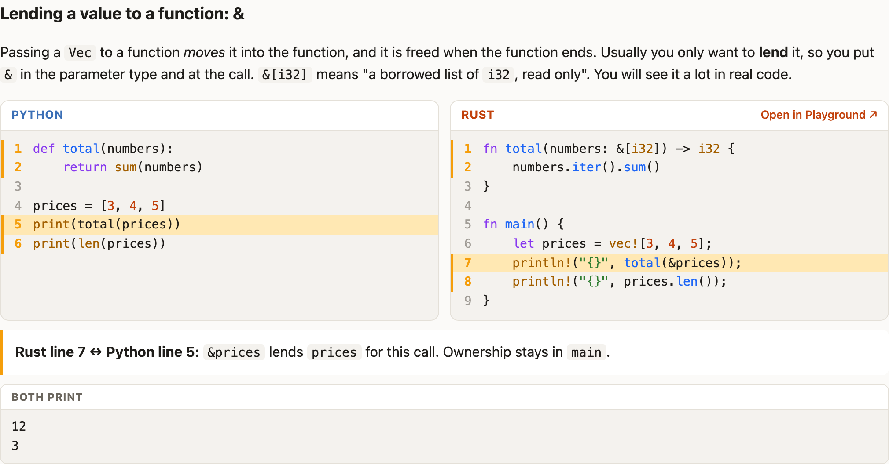
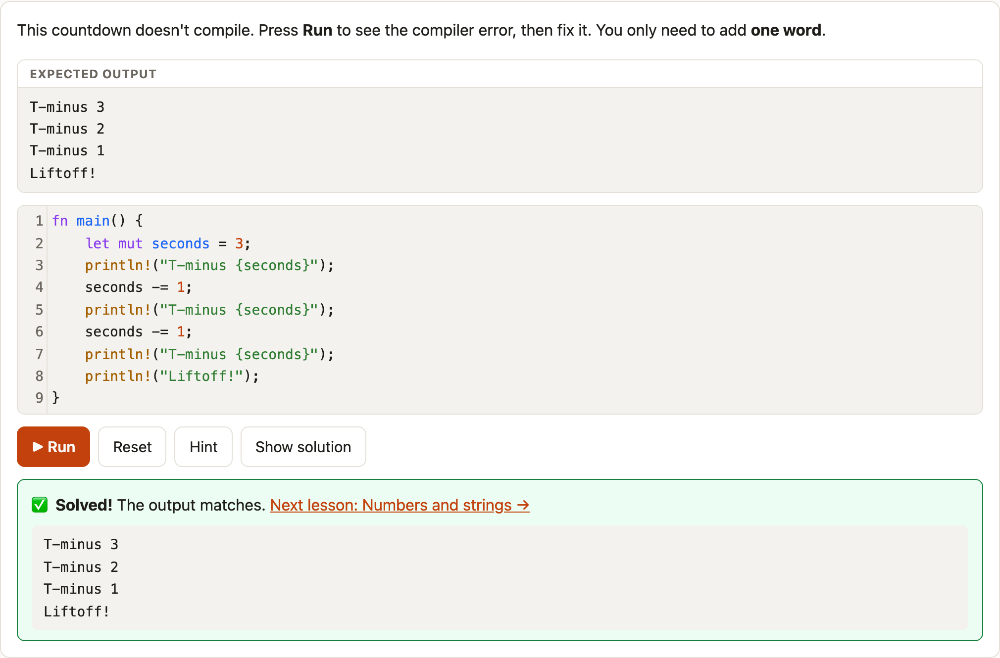

<div align="center">

# 🦀 Rust for Pythonistas

**Learn to read Rust, and make small changes to it, using the Python you already know.**

A free, interactive course: Python and Rust side by side, quizzes, and exercises that compile on the official Rust Playground. Nothing to install.

[](https://romanzdk.github.io/rust-for-pythonistas/)

[](https://github.com/romanzdk/rust-for-pythonistas/actions/workflows/check.yml)
[](LICENSE)


</div>



## Why this course

You know Python well. Rust keeps showing up in the tools you use (uv, ruff, polars, pydantic-core) and in code you
have to review or change at work. You don't need to become a Rust author. You need to **read** Rust confidently and
make **small, safe changes**, guided by the compiler.

Most Rust courses start from zero and aim at writing large programs. This one starts from Python and aims at reading.

## How a lesson works

| | |
|---|---|
| **1 · Side by side** | Python on the left, Rust on the right. Hover over or tap a marked Rust line to light up the matching Python line and read a short note on how to read it. |
| **2 · Read it** | Short questions you answer by reading only: *what does this print*, *does this compile*, *what type is this*. |
| **3 · Change it** | A small edit to real Rust code. **Run** compiles it on the official [Rust Playground](https://play.rust-lang.org) and checks the result. |
| **4 · Cheat card** | A Python ↔ Rust lookup table for the topic, to come back to later. |

Examples that fail on purpose show the real compiler error, and you can open the fixed version next to it.

<p align="center"></p>

## Lessons

**Get started**

| # | Lesson | What you learn |
|---|---|---|
| 1 | [Your first Rust project](https://romanzdk.github.io/rust-for-pythonistas/#/project) | `cargo new` next to `uv init`: the files you get, `Cargo.toml` next to `pyproject.toml`, `cargo run` |
| 2 | [A tiny app: a function and a module](https://romanzdk.github.io/rust-for-pythonistas/#/first-app) | Write a function, move it into its own file with `mod`, `pub` and `use`, and run it |

**The language**

| # | Lesson | What you learn |
|---|---|---|
| 3 | [Hello, variables and mut](https://romanzdk.github.io/rust-for-pythonistas/#/basics) | `println!`, `let`, `mut`, shadowing, and why there are semicolons |
| 4 | [Numbers and strings](https://romanzdk.github.io/rust-for-pythonistas/#/types) | Fixed-size numbers, casts with `as`, and the two string types |
| 5 | [Functions and expressions](https://romanzdk.github.io/rust-for-pythonistas/#/functions) | Required types, the last expression as the return value, expressions everywhere |
| 6 | [if, loops and ranges](https://romanzdk.github.io/rust-for-pythonistas/#/control-flow) | `if` needs a real bool, `0..5` is `range(5)`, `while`, and `loop` with a break value |
| 7 | [Vec and HashMap](https://romanzdk.github.io/rust-for-pythonistas/#/collections) | A list is a `Vec`, a dict is a `HashMap`, plus slices, tuples, and why map order is random |
| 8 | [Iterators and closures](https://romanzdk.github.io/rust-for-pythonistas/#/iterators) | List comprehensions become `.iter().filter().map().collect()` |
| 9 | [Structs and impl](https://romanzdk.github.io/rust-for-pythonistas/#/structs) | A struct plus an `impl` block is a class: fields, a constructor and methods |
| 10 | [Enums and match](https://romanzdk.github.io/rust-for-pythonistas/#/enums) | Variants that carry data, and a `match` that must handle all of them |
| 11 | [Option instead of None](https://romanzdk.github.io/rust-for-pythonistas/#/option) | A value that might be missing, and the compiler making you handle it |
| 12 | [Result and ? instead of exceptions](https://romanzdk.github.io/rust-for-pythonistas/#/result) | Errors in the return type: `Ok`, `Err`, `?`, `unwrap`, your own error enum |
| 13 | [Ownership and borrowing](https://romanzdk.github.io/rust-for-pythonistas/#/ownership) | Move, `&`, `&mut` and `.clone()`: the rules behind most Rust errors |
| 14 | [Traits instead of duck typing](https://romanzdk.github.io/rust-for-pythonistas/#/traits) | `trait`, `impl`, default methods, generic bounds, `Display` and `derive` |
| 15 | [Reading compiler errors](https://romanzdk.github.io/rust-for-pythonistas/#/compiler-errors) | How to read a rustc error from the top and let its `help:` lines tell you the fix |

**Real projects**

| # | Lesson | What you learn |
|---|---|---|
| 16 | [Building and running a real program](https://romanzdk.github.io/rust-for-pythonistas/#/cli) | Arguments, files, stdin, environment variables, exit codes, and a Dockerfile |
| 17 | [Cargo in depth: dependencies and workspaces](https://romanzdk.github.io/rust-for-pythonistas/#/cargo) | The full `Cargo.toml`, `Cargo.lock`, dependencies, features, submodules, workspaces |
| 18 | [Tests, builds and shipping](https://romanzdk.github.io/rust-for-pythonistas/#/testing-shipping) | `#[test]`, reading `cargo test` output, release builds, crates.io, Rust inside Python wheels |
| 19 | [Reading real code](https://romanzdk.github.io/rust-for-pythonistas/#/real-code) | Modules, attributes, lifetimes, and a realistic program to read line by line |

## Every example is checked

A course is only useful if its examples are right, so CI checks **every** example on every push
([`scripts/check.mjs`](scripts/check.mjs)):

- Every Python and Rust program runs, and both must print exactly the output the lesson shows.
- "Does it compile?" and "What does it print?" answers are checked against the real `rustc` and real output.
- Examples that fail on purpose must fail with the exact error shown, and their fixed versions must run.
- Every exercise solution must pass, and no starter code may pass before you change it.
- Command-line examples run with the arguments, files, stdin and environment variables the page shows, and must
  give the shown output, stderr and exit code.
- `Cargo.toml`, terminal commands, `cargo test` output, the Dockerfile and the PyO3 example are checked by running the
  real tools (`cargo`, `uv`, `pytest`, `docker`, `maturin`) on exactly what the page shows.

## Run it locally

It is a static site with no build step:

```sh
git clone https://github.com/romanzdk/rust-for-pythonistas.git
cd rust-for-pythonistas
python3 -m http.server 8000   # then open http://localhost:8000
```

To run the checks you need `rustc`/`cargo` (stable), `python3`, `uv`, `docker`, `node` and network access:

```sh
node scripts/check.mjs            # all lessons
node scripts/check.mjs ownership  # one lesson
```

## Contributing

Found a mistake, or have an idea for a lesson? [Open an issue](https://github.com/romanzdk/rust-for-pythonistas/issues/new/choose).
To change or add a lesson, see [CONTRIBUTING.md](CONTRIBUTING.md). Each lesson is one JavaScript file in `lessons/`.
The design notes are in [docs/design.md](docs/design.md).

## License

[MIT](LICENSE) © Roman Žydyk
